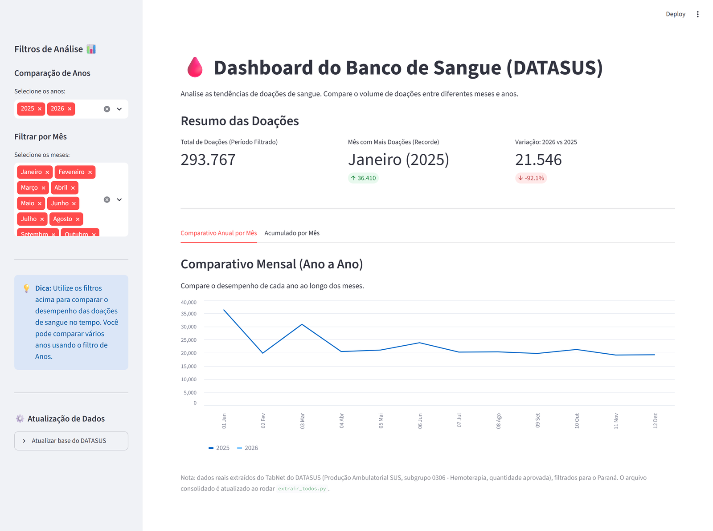

# Bloody Mary - DATASUS hemotherapy data, extraction and analysis

English · [Português](README.pt-br.md)

A project that automates the extraction of hemotherapy data for the state of Paraná
from the DATASUS TabNet (SUS Outpatient Production), treats the data and presents it
in a dashboard.

> **At a glance**
> - **What:** an RPA pipeline that pulls public hemotherapy data from DATASUS, cleans it and charts it.
> - **Problem:** the TabNet only answers one manual query at a time, through a slow form.
> - **My part:** the project idea and the extraction and treatment modules.
> - **Highlights:** parallel extraction with checkpoints, layered fallbacks and per-period failure isolation (see [Reliability](#reliability)).

Team project. Final project of the Python Programming course at Harve (technology
school), April 2026.



## Team and roles

| Person | Contribution |
|---|---|
| Giovanna Ribas dos Reis ([@ribasgiovanna](https://github.com/ribasgiovanna)) | Project idea (using blood bank / hemotherapy data) and work on the extraction (`src/rpa/extrator_datasus.py`) and treatment (`src/processing/tratamento.py`) modules |
| Jackson Beggi ([@JacksonBeggi](https://github.com/JacksonBeggi)) | RPA orchestration, parallel extraction and integration |
| wingCODING ([@WingCODING](https://github.com/WingCODING)) | RPA orchestration and dashboard |

This repository is a copy kept on Giovanna's account. The commit history is concentrated
in the teammates' accounts because of the workflow at the time (one person merging the
branches). Origin repositories: [JacksonBeggi/Projeto_Harve](https://github.com/JacksonBeggi)
and [WingCODING/datasus](https://github.com/WingCODING/datasus).

## What it does

1. **Extraction (RPA)** - opens the DATASUS TabNet in the browser (Selenium), selects
   row, column, content, period, state and procedure subgroup, and reads the result
   table (`pandas.read_html` with a BeautifulSoup fallback).
   - Selectors by `id` to work around special characters in the `name` attributes
     (`SRegião`, `SMunicípio`)
   - Explicit waits on every interaction
   - Tab switching by polling `window_handles` with a timeout
2. **Batch extraction** (`extrair_todos.py`) - runs several periods in parallel
   (3 workers), with a stagger between them, checkpointing (skips what was already
   downloaded) and consolidation of the individual Excel files into a single one.
3. **Treatment** (`src/processing/tratamento.py`) - removes DATASUS "Total" footers,
   empty rows and columns, normalizes column names and saves the processed result
   as CSV.
4. **Dashboard** (`frontMain.py`) - a Streamlit view to compare volume across months
   and years.

## Reliability

TabNet is an old, slow government system, so the pipeline is built to keep going when a
step fails instead of losing the whole run.

| Situation | How it is handled |
|---|---|
| A period fails (timeout, browser error) | Each period runs in its own process; the error is caught, the period is listed as failed at the end, and the others continue |
| A period returns no rows | Counted as a failure and reported, not silently saved as empty |
| The run is interrupted | Checkpoint: each period is saved as its own Excel file, and a new run skips periods that already have one |
| Slow pages | Explicit waits on every interaction (20 s) and a 60 s page-load limit, instead of fixed sleeps |
| Filter hidden or option not found by its label | The filter is expanded first; options are selected by visible text, then by value, then via JavaScript |
| Result does not open in a new tab | Polling of `window_handles` with a timeout, then falls back to the current tab |
| Table cannot be read one way | Three strategies in cascade: direct CSV download, then the `tabdados` table via BeautifulSoup, then `pandas.read_html` |
| Server load | 3 workers only, started 10 s apart |
| A file cannot be read during consolidation | It is skipped with a warning; the remaining periods are still consolidated |
| DATASUS "Total" rows and empty rows/columns | Removed during treatment so they do not distort sums and averages |

**Known limitations:** failed periods are not retried automatically within the same run
(running the script again retries only what is missing); the checkpoint trusts that an
existing file is complete; and a change in the TabNet page structure is detected only when
a selector fails, since the output columns are not validated against a schema yet.

## Data

Real data extracted from the DATASUS TabNet - SUS Outpatient Production, procedure
subgroup 0306 (Hemotherapy), "approved quantity" metric, filtered to the state of
Paraná. It reflects approved hemotherapy procedures recorded in SUS, which is an
indicator related to - but not identical to - blood donations.

## Tech

- Python 3
- Selenium (browser automation)
- pandas, openpyxl, lxml, BeautifulSoup
- Streamlit (dashboard)

## Structure

```
.
├── main.py                       # single-period extraction (entry point)
├── extrair_todos.py              # parallel extraction of all periods + consolidation
├── frontMain.py                  # Streamlit dashboard
├── config/
│   └── config.py                 # TabNet URL, directories, timeouts
└── src/
    ├── rpa/
    │   └── extrator_datasus.py   # DATASUS navigation and table extraction
    └── processing/
        └── tratamento.py         # data cleaning and normalization
```

## Running

```bash
pip install -r requirements.txt

python main.py            # extract one period
python extrair_todos.py   # extract all periods in parallel
streamlit run frontMain.py
```

Extraction uses Selenium and opens a browser; the matching WebDriver must be available.
